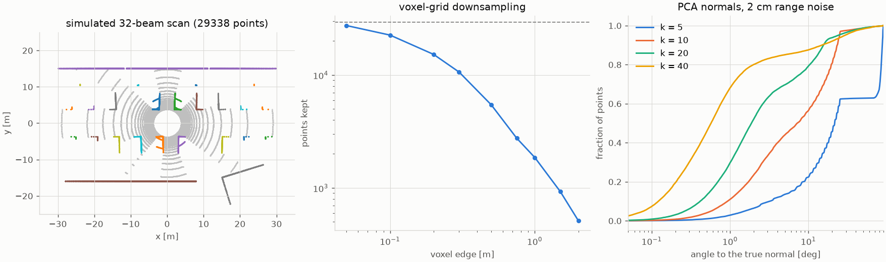

# 4 · Point clouds: representation, voxel grids, k-d trees, normals

Chapters 1–3 located the vehicle with GNSS. From here on the second sensor is a LiDAR, which measures the
geometry *around* the vehicle as a set of 3-D points. Every later chapter (registration, fusion, mapping,
dynamic objects) works on these point sets, and almost all of them need the same three building blocks: a way
to **thin** a cloud uniformly (voxel grid), a way to **find neighbours** fast (k-d tree), and the **local
surface orientation** at each point (normals). This chapter writes the three and checks them against brute
force and against a simulator with exact ground truth.

Code: [`cloud.hpp`](../cpp/include/sensor_fusion/cloud.hpp), [`sim.hpp`](../cpp/include/sensor_fusion/sim.hpp) ·
tests: [`test_cloud.cpp`](../cpp/tests/test_cloud.cpp) ·
notebook: [`04_point_clouds.ipynb`](../2_notebooks/solutions/04_point_clouds.ipynb)

---

## 4.1 How a LiDAR measures, and a simulator

A spinning LiDAR fires laser pulses along rays $\mathbf o + t\,\mathbf d$ from the sensor origin $\mathbf o$ and
measures the time of flight of the first echo, i.e. the range

$$
r = \min\{\,t > t_{\min} : \mathbf o + t\,\mathbf d \in \text{surface}\,\}, \qquad
\mathbf p = r\,\mathbf d,\quad
\mathbf d = [\cos\epsilon\cos\alpha,\ \cos\epsilon\sin\alpha,\ \sin\epsilon]^\top
\tag{4.1}
$$

for each beam elevation $\epsilon$ and azimuth step $\alpha$. A multi-beam sensor has a fixed set of elevations
(16–128 beams); one revolution produces one **scan**. A planar scanner is the special case of one beam at
$\epsilon = 0$.

Two properties of this sampling matter in everything that follows:

* **Density falls with range** — neighbouring rays diverge, so a surface at 20 m gets a quarter of the points
  per square metre it would get at 10 m.
* **Sampling is anisotropic** — along a ring the azimuth step is small (0.35° at 1024 steps), between rings the
  elevation step is large (1.1° for 32 beams over 35°). On the ground the rings are concentric circles
  (Figure 4.1, left) with gaps between them many times wider than the spacing along them.

The module's simulator (`sim::simulate_lidar`) ray-casts (4.1) against a ground plane and oriented boxes (the
`demo_scene()` parking lot: two rows of cars, three buildings, four light posts), adds Gaussian range noise, and
returns for every point its label and its **true surface normal** — the ground truth the tests use.

## 4.2 Representation and files

A cloud is an $n$-column matrix of points, plus optional per-point fields (intensity, ring/beam number, time,
label). In C++ it is `Eigen::Matrix<double, 3, Eigen::Dynamic>` (one point per column), in Python an
$(n, 3)$ array. Points come in the **sensor frame**; chapter 5 moves them into a common frame.

The **PCD** format of the Point Cloud Library stores exactly this: a text header (`FIELDS`, `SIZE`, `TYPE`,
`COUNT`, `WIDTH`, `HEIGHT`, `VIEWPOINT`, `POINTS`, `DATA`) followed by the data as ASCII lines or packed binary
records. `cloud::read_pcd` reads both (field types F, I, U of 1–8 bytes) into a field table; `write_pcd` writes
them. The repository ships two recorded files:

* `data/parking_lot/run1_scan000_ascii.pcd` — the first scan of run 1 as ASCII, 177 points;
* `data/parking_lot/run1_scans.pcd` — 484 planar scans of the same run, 111 194 points with fields
  `x y z intensity beam scan`, packed binary; `run1_scans.csv` gives each scan's time stamp. Ranges are
  0.15–12 m (median 5.4 m) and $z = 0$: a 2-D scanner. Chapters 5 and 6 use them with the GNSS fixes of the
  same run.

## 4.3 Voxel-grid downsampling

A scan has up to hundreds of thousands of points, very dense near the sensor and sparse far away. A **voxel
grid** divides space into cubes of edge $\ell$ anchored at $\mathbf o$; the key of point $\mathbf p$ is

$$
\mathbf k(\mathbf p) = \left\lfloor \frac{\mathbf p - \mathbf o}{\ell} \right\rfloor \in \mathbb Z^3,
\tag{4.2}
$$

and all points sharing a key are replaced by their centroid

$$
\bar{\mathbf p}_{\mathbf k} = \frac{1}{\lvert V_{\mathbf k}\rvert}\sum_{\mathbf p \in V_{\mathbf k}} \mathbf p .
\tag{4.3}
$$

### Algorithm 4.1 — voxel grid

1. For every point compute its key (4.2); look it up in a hash map from key to voxel index, creating a new
   voxel on first sight.
2. Accumulate the sum and the count of each voxel.
3. Output the centroids (4.3), in order of first occurrence, and for every input point its voxel index.

The result has at most one point per $\ell^3$ cube: near the sensor the density drops by orders of magnitude,
far away (one point per voxel already) nothing changes. On the simulated scan of Figure 4.1 (29 338 points), a
0.1 m grid keeps 77 % of the points, 0.5 m keeps 19 % and 1 m keeps 6 %. The plain mean of the output is *not*
the mean of the input (dense voxels count once, like sparse ones); the count-weighted mean of the centroids is,
which a test checks, together with a hand-worked example of (4.2)–(4.3) including negative keys. Using the
centroid instead of the voxel centre keeps sub-voxel accuracy on surfaces.

## 4.4 Nearest neighbours: the k-d tree

Normals, ICP (chapter 5) and clustering (chapter 8) all ask "which points are closest to $\mathbf q$?". Brute force
costs $O(n)$ per query. A **k-d tree** splits the points recursively in two halves along one coordinate,
building a balanced binary tree of depth $\approx \log_2(n / \text{leaf size})$.

### Algorithm 4.2 — build and query

*Build* (range of points, depth):
1. If the range holds at most `leaf_size` points, make a leaf.
2. Otherwise choose the coordinate with the largest spread, split at its median (`nth_element`, $O(n)$),
   recurse on both halves.

*Query* ($k$ nearest of $\mathbf q$):
1. Descend to the leaf containing $\mathbf q$, keeping a max-heap of the best $k$ candidates.
2. On the way back up, visit the other child of a node only if the slab beyond its splitting plane can contain
   a closer point: $(q_a - s)^2 < $ current $k$-th best squared distance.

A radius search is the same with a fixed bound. Building costs $O(n \log n)$; a query costs $O(\log n)$ on
average for well-spread data in low dimension. On the 29 338-point scan the tree (leaf size 10) has depth 13;
in the notebook 300 10-NN queries take under a millisecond with it and about a third of a second with NumPy
brute force (timings depend on the machine) — and the gap grows linearly with $n$. The tests compare every k-NN and radius result with `brute_force_knn` in 2-D and
3-D, including duplicates, $k > n$ and empty trees.

## 4.5 Surface normals by local PCA

The normal at $\mathbf p$ is estimated from its $k$ nearest neighbours $\mathcal N$ (the point itself included):
their centroid and covariance

$$
\bar{\mathbf p} = \frac1k\sum_{\mathbf q\in\mathcal N}\mathbf q, \qquad
\mathbf C = \frac1k\sum_{\mathbf q\in\mathcal N}(\mathbf q - \bar{\mathbf p})(\mathbf q - \bar{\mathbf p})^\top,
\tag{4.4}
$$

have eigenvalues $\lambda_0 \le \lambda_1 \le \lambda_2$ with eigenvectors $\mathbf v_0, \mathbf v_1, \mathbf v_2$. The
best-fitting plane through $\bar{\mathbf p}$ (least squares in the orthogonal distance) has normal

$$
\mathbf n = \mathbf v_0 ,
\tag{4.5}
$$

and the **surface variation**

$$
\sigma = \frac{\lambda_0}{\lambda_0 + \lambda_1 + \lambda_2} \in [0, \tfrac13]
\tag{4.6}
$$

is 0 on a perfect plane and grows at edges, corners and in noise. The sign of an eigenvector is arbitrary;
normals are flipped to face the sensor: $\mathbf n^\top(\mathbf o - \mathbf p) \ge 0$. In 2-D the same formulas
give the normal of the best-fitting line.

### Algorithm 4.3 — normals of a cloud

For each point: k-NN in the tree, (4.4), the eigen-decomposition of the $3 \times 3$ symmetric $\mathbf C$,
(4.5)–(4.6), orient towards the viewpoint.

**How many neighbours?** Figure 4.1 (right) compares the estimated normals of the simulated scan, with 2 cm range
noise, to the true ones. With $k = 5$ the median error is 22° and 78 % of the points are off by more than 10°;
with $k = 10$, 7.2° and 43 %; $k = 20$, 1.9° and 21 %; $k = 40$, 0.6° and 12 %. Two effects explain it:

* **Noise against extent.** The tilt of a plane fitted to points spread over a width $w$ with noise $\sigma_r$ is
  of the order $\sigma_r / w$; small neighbourhoods are narrow.
* **Degenerate neighbourhoods.** With few neighbours on the ground, all of them lie on *one ring* — nearly a
  line, $\lambda_1 \ll \lambda_2$. The plane through them is then pinned by the ring's direction and by the range
  noise, which acts *along the rays*, not by the ground: its normal can tilt anywhere up to 90° (the notebook shows
  a 5-point ground neighbourhood with $\lambda_1/\lambda_2 = 0.15$ whose normal is 23° off). The jump of the
  $k = 5$ curve to 90° is these points. A neighbourhood must span at least two rings.

Large $k$ has its own failure: neighbourhoods that cross an edge mix two surfaces (the 12 % tail of $k = 40$ are
the points near car and building edges). The test therefore checks the normals only where the neighbourhood
lies on one surface and is not a line, and there all of them are within 2.6° (cosine > 0.999) of the truth.

*Figure 4.1 — Left: a simulated 32-beam scan from 1.8 m above the demo parking lot (ground grey, objects
coloured by id). Middle: points kept by a voxel grid against its edge. Right: distribution of the angle between
PCA normals and the true normals for 5–40 neighbours, 2 cm range noise. Generated by `tools/make_figures.py 4`.*

## 4.6 Common mistakes

- **Voxel keys by truncation** — `int((p - o) / l)` rounds towards zero, so the voxels either side of the
  origin are twice as large. Use `floor`.
- **Coarse downsampling before estimating normals with a fixed $k$** — the neighbourhoods then span metres. On
  open ground this even helps (it removes the ring anisotropy: on the scan of Figure 4.1 the median error drops
  from 1.9° to 0.5° with a 0.5 m grid and $k = 20$), but on objects the share of normals off by more than 10° rises
  from 10 % to 43 %, because neighbourhoods cross edges. Choose the grid for the smallest surface you care about.
- **Unoriented normals** — the eigen-solver's sign is arbitrary; flip towards the sensor, or point-to-plane ICP
  and visualisation go wrong half of the time.
- **Trusting normals with large surface variation** — at edges and in degenerate neighbourhoods (4.6) flags
  them; skip or down-weight them.
- **Mixing frames** — points come in the sensor frame; transform them before merging scans (chapter 5).
- **Brute-force neighbours in a loop** — $O(n^2)$ for normals of a whole scan; build the tree once.

## 4.7 References

- R. B. Rusu, *Semantic 3D Object Maps for Everyday Robot Manipulation*, Springer, 2013 — chapter 4 (normals,
  surface variation, PCD).
- J. L. Bentley, "Multidimensional binary search trees used for associative searching", *Communications of the
  ACM* 18(9):509–517, 1975.
- J. H. Friedman, J. L. Bentley, R. A. Finkel, "An algorithm for finding best matches in logarithmic expected
  time", *ACM Trans. Mathematical Software* 3(3):209–226, 1977.
- H. Hoppe, T. DeRose, T. Duchamp, J. McDonald, W. Stuetzle, "Surface reconstruction from unorganized points",
  *SIGGRAPH*, 1992 — PCA normals.
- M. Pauly, M. Gross, L. P. Kobbelt, "Efficient simplification of point-sampled surfaces", *IEEE Visualization*,
  2002 — surface variation.
- Point Cloud Library, "The PCD (Point Cloud Data) file format", https://pointclouds.org/documentation/tutorials/pcd_file_format.html.
