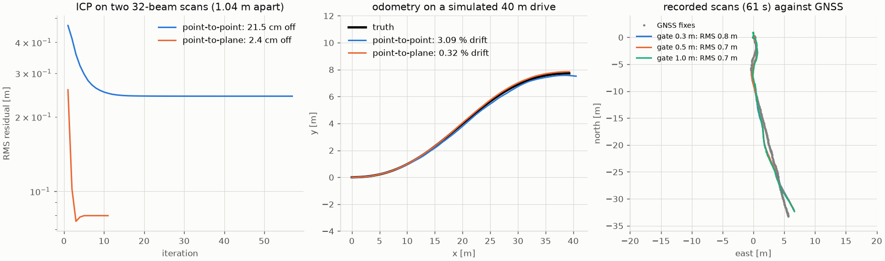

# 5 · Registration: ICP, NDT, LiDAR odometry and its drift

Two scans of the same place taken from two poses differ by the rigid motion between the poses. **Registration**
finds that motion by aligning the scans. Chained from scan to scan it becomes **LiDAR odometry** — a motion
estimate from the LiDAR alone, which chapter 6 fuses with GNSS. This chapter derives the closed-form alignment of
matched points, builds ICP on it with the two classic error metrics, sketches NDT, and measures odometry and its
drift on a simulated drive and on the recorded scans.

Code: [`registration.hpp`](../cpp/include/sensor_fusion/registration.hpp) ·
tests: [`test_registration.cpp`](../cpp/tests/test_registration.cpp) ·
notebook: [`05_registration.ipynb`](../2_notebooks/solutions/05_registration.ipynb)

---

## 5.1 The problem

Given a **source** cloud $\{\mathbf p_i\}$ and a **target** cloud $\{\mathbf q_j\}$, find the rigid transform
$T = (\mathbf R, \mathbf t)$ that maps the source onto the target:

$$
\min_{\mathbf R \in SO(d),\, \mathbf t}\ \sum_i \big\lVert \mathbf R\mathbf p_i + \mathbf t - \mathbf q_{c(i)} \big\rVert^2 ,
\tag{5.1}
$$

where $c(i)$ is the target point that $\mathbf p_i$ corresponds to. If the correspondences were known, (5.1) would
have a closed-form solution (section 5.2). They are not: LiDAR points are samples, not features, and no point of
one scan is exactly re-measured in the next. ICP guesses them.

Conventions in the code: $T$ maps source coordinates into the target frame, so with the source the *newer* scan
$k$ and the target the older scan $k-1$, $T = T_{k-1,k}$, the pose of scan $k$ in the frame of scan $k-1$.

## 5.2 Matched points: the closed form

With known pairs $(\mathbf p_i, \mathbf q_i)$, $i = 1..n$, the optimal translation aligns the centroids,
$\mathbf t = \bar{\mathbf q} - \mathbf R\bar{\mathbf p}$, and the rotation solves an orthogonal Procrustes problem
(Arun et al. 1987, Umeyama 1991):

$$
\mathbf H = \sum_i (\mathbf q_i - \bar{\mathbf q})(\mathbf p_i - \bar{\mathbf p})^\top = \mathbf U\boldsymbol\Sigma\mathbf V^\top,
\qquad
\mathbf R = \mathbf U\,\mathrm{diag}(1, \dots, 1, \det(\mathbf U\mathbf V^\top))\,\mathbf V^\top .
\tag{5.2}
$$

The determinant factor excludes reflections, which the plain $\mathbf U\mathbf V^\top$ returns for degenerate (e.g.
coplanar) or very noisy sets. The cost that is minimized is

$$
\sum_i \lVert \mathbf q_i - \mathbf R\mathbf p_i - \mathbf t\rVert^2
= \sum_i \lVert \tilde{\mathbf q}_i\rVert^2 + \lVert \tilde{\mathbf p}_i\rVert^2 - 2\,\mathrm{tr}(\mathbf R^\top\mathbf H),
\tag{5.3}
$$

(tildes: centred points), so maximizing $\mathrm{tr}(\mathbf R^\top\mathbf H)$ over rotations gives (5.2). The tests check
that `best_rigid` recovers random 2-D and 3-D transforms to $10^{-12}$ and returns $\det\mathbf R = +1$ for a mirrored
coplanar set.

## 5.3 Iterative closest point

### Algorithm 5.1 — ICP (Besl & McKay 1992; Chen & Medioni 1992)

Input: source, target, initial guess $T_0$. Build a k-d tree of the target once (chapter 4).

1. **Match**: transform the source with the current $T$; pair every point with its nearest target point.
2. **Reject**: drop pairs farther apart than a gate $d_{\max}$; optionally keep only the closest fraction
   (*trimming*), which removes the parts seen in one scan only.
3. **Minimize** the error metric over an increment $\Delta T$ (closed form (5.2), or one Gauss–Newton step of
   (5.5)); set $T \leftarrow \Delta T\, T$.
4. Stop when $\Delta T$ moves less than a tolerance, or after a maximum number of iterations.

Each iteration cannot increase the point-to-point cost with fixed pairs, and re-matching can only lower it
again, so ICP converges — to the *nearest local* minimum. It needs a good initial guess.

## 5.4 Point-to-plane

Point-to-point (5.1) asks the samples to coincide, but samples of a surface never do: two scans of a wall are
two different sets of points *on* the wall. Point-to-plane measures only the distance along the target normal
$\mathbf n_j$ (chapter 4), and lets points slide along the surface:

$$
r_i = \mathbf n_{c(i)}^\top\big(\mathbf R\mathbf p_i + \mathbf t - \mathbf q_{c(i)}\big) .
\tag{5.4}
$$

There is no closed form; linearizing the increment $\mathbf R \approx \mathbf I + [\boldsymbol\omega]_\times$ gives a linear least
squares problem in $\mathbf x = (\boldsymbol\omega, \mathbf t)$:

$$
r_i \approx \underbrace{\big[(\mathbf p_i \times \mathbf n_i)^\top,\ \mathbf n_i^\top\big]}_{\mathbf J_i}\mathbf x + \mathbf n_i^\top(\mathbf p_i - \mathbf q_i),
\qquad
\mathbf x = -\Big(\sum_i\mathbf J_i^\top\mathbf J_i\Big)^{-1}\sum_i\mathbf J_i^\top r_i^{(0)},
\tag{5.5}
$$

and in 2-D $\mathbf J_i = [\,\mathbf n_i^\top \mathbf p_i^\perp,\ \mathbf n_i^\top]$ with $\mathbf p^\perp = (-p_y, p_x)$. The increment is then applied as a
true rotation (exponential map) and the matching repeated.

**What the measurements show** (Figure 5.1, left; the scans of chapter 4 taken 1.04 m apart, 1 cm range noise,
gate 2 m):

* **Point-to-plane is accurate and fast**: 11 iterations, 2.4 cm off; with 20 % trimming 0.04 cm.
* **Point-to-point is biased on a 3-D LiDAR**: 57 iterations and 21.5 cm off. The rings on the ground are drawn
  around the sensor, so they *move with it*: their nearest-neighbour pairs say "no motion" and hold the estimate
  back. With the ground removed, point-to-point is 1.3 cm off (and point-to-plane 0.2 cm). Chapter 8 removes the
  ground without labels.
* **Point-to-plane has a smaller basin of convergence.** From 50 random starts on 2-D scans, both converge from
  1 m and 10° off; from 2 m and 20°, point-to-point 92 % and point-to-plane 14 %; from 3 m and 30°, 18 % and 0 %. The
  linearization assumes small rotations, and normals pull towards the wrong wall when the first matches are
  wrong. A coarse point-to-point stage, a good motion prior (section 5.6) or a global method (features, NDT, a
  branch-and-bound search) is needed far from the solution.

## 5.5 NDT in brief

The **normal distributions transform** (Biber & Straßer 2003; Magnusson 2009) replaces the target points by a
voxel grid of Gaussians: each voxel stores the mean $\boldsymbol\mu_v$ and covariance $\boldsymbol\Sigma_v$ of its points.
The source is scored by the likelihood of its transformed points,
$s(T) = \sum_i \exp\big(-\tfrac12(T\mathbf p_i - \boldsymbol\mu_v)^\top\boldsymbol\Sigma_v^{-1}(T\mathbf p_i - \boldsymbol\mu_v)\big)$, maximized with
Newton's method. No nearest-neighbour search is needed, the score is smooth, and $\boldsymbol\Sigma_v$ encodes the local
surface (a flat voxel has one small eigenvalue — a point-to-plane metric in disguise). Its accuracy depends on
the voxel size, and like ICP it converges locally. Autoware and many automotive localizers match scans to a
prior NDT map. This module implements ICP only.

## 5.6 LiDAR odometry and its drift

Registering every scan to the previous one and chaining the results gives the trajectory

$$
T_{0,k} = T_{0,k-1}\, T_{k-1,k}, \qquad T_{0,0} = \mathbf I .
\tag{5.6}
$$

The initial guess of each registration is the previous motion (**constant velocity**): at 8 Hz the vehicle
moves at most a few tens of centimetres between scans, well inside the basin. Every step has a small error,
and (5.6) accumulates them: position error grows with distance, and a heading error $\delta\psi$ turns into a
lateral error $\approx \delta\psi \cdot$ distance travelled. Nothing in odometry bounds it — that is what GNSS (chapter
6) and loop closures are for.

**Simulated drive** (Figure 5.1, middle). A planar scanner 1 m above the demo parking lot drives 40.3 m along an
S-curve, 101 scans, 1 cm range noise, gate 1 m. Point-to-plane ends 13 cm from the truth (0.32 % of the distance),
point-to-point 1.25 m (3.1 %). There is no ground in a planar scan, but the samples of a wall still sit at different
places in successive scans, and point-to-point pairs pull them together; point-to-plane lets them slide.

**Recorded scans** (Figure 5.1, right). The 484 planar scans of run 1 (61 s) with point-to-plane ICP end 32.6–33.9 m
from the start, depending on the gate (0.3–1 m), against 33.7 m between the first and last GNSS fix of the same
interval. After a rigid alignment to the 243 fixes (the scanner's heading in ENU is not known here; chapter 6
estimates it) the RMS distance is 0.7–0.8 m — comparable to the GNSS noise itself. Which of the two is right
locally cannot be decided from either alone; chapter 6 fuses them.

*Figure 5.1 — Left: RMS residual against iteration for point-to-point and point-to-plane ICP on two simulated
32-beam scans, with the final pose error. Middle: odometry on a simulated 40 m drive. Right: odometry from the
recorded scans for three gates, aligned to the GNSS fixes of the same 61 s. Generated by
`tools/make_figures.py 5`.*

## 5.7 Common mistakes

- **Mixing up the direction of $T$.** Registering scan $k$ (source) to scan $k-1$ (target) gives $T_{k-1,k}$;
  chaining needs $T_{0,k-1}T_{k-1,k}$, not the inverse.
- **Starting from identity at speed.** At 20 m/s and 10 Hz the scans are 2 m apart: use the previous motion, an
  IMU or wheel odometry as the initial guess.
- **No outlier gate.** Points seen in only one scan (new objects, the far end of the field of view) pull the
  estimate; gate and trim them.
- **Point-to-point ICP with the ground rings in the cloud** — biased towards zero motion; remove the ground or
  use point-to-plane.
- **Normals of the source instead of the target** in (5.4), or unoriented normals: the sign does not matter for
  the squared residual, but normals of a mixed neighbourhood do.
- **Trusting the final RMS residual** as a measure of accuracy: a converged-but-wrong ICP (local minimum) can
  have a small residual. Check against an independent estimate.

## 5.8 References

- P. J. Besl, N. D. McKay, "A method for registration of 3-D shapes", *IEEE Trans. PAMI* 14(2):239–256, 1992.
- Y. Chen, G. Medioni, "Object modelling by registration of multiple range images", *Image and Vision
  Computing* 10(3):145–155, 1992 — point-to-plane.
- K. S. Arun, T. S. Huang, S. D. Blostein, "Least-squares fitting of two 3-D point sets", *IEEE Trans. PAMI*
  9(5):698–700, 1987.
- S. Umeyama, "Least-squares estimation of transformation parameters between two point patterns", *IEEE Trans.
  PAMI* 13(4):376–380, 1991.
- S. Rusinkiewicz, M. Levoy, "Efficient variants of the ICP algorithm", *3DIM*, 2001.
- F. Pomerleau, F. Colas, R. Siegwart, "A review of point cloud registration algorithms for mobile robotics",
  *Foundations and Trends in Robotics* 4(1):1–104, 2015.
- P. Biber, W. Straßer, "The normal distributions transform: a new approach to laser scan matching", *IROS*, 2003.
- M. Magnusson, *The Three-Dimensional Normal-Distributions Transform*, PhD thesis, Örebro University, 2009.
- J. Zhang, S. Singh, "LOAM: Lidar odometry and mapping in real-time", *RSS*, 2014.
