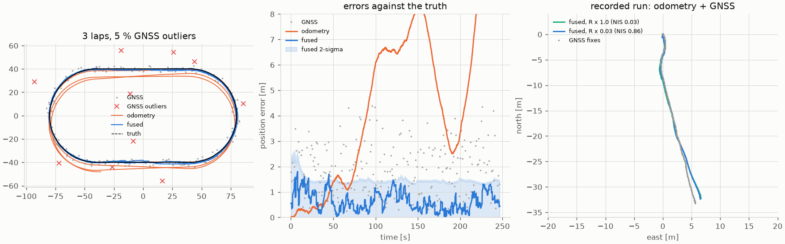

# 6 · Loosely coupled GNSS + LiDAR fusion

GNSS (chapters 1–3) is absolute but noisy and occasionally wrong by tens of metres; LiDAR odometry (chapter 5)
is smooth and locally precise but drifts without bound. Their errors are complementary, and a Kalman filter
combines them: odometry *predicts* the motion, GNSS *corrects* the position. The combination is **loosely
coupled** — the filter uses each sensor's finished output (a position fix, a relative pose) rather than raw
pseudoranges or raw points. This chapter writes the filter on the planar pose, adds a chi-square gate against
GNSS outliers, and — most of the chapter — checks when its uncertainty can be believed.

Code: [`fusion.hpp`](../cpp/include/sensor_fusion/fusion.hpp), synthetic drives in
[`scenarios.py`](../python/sensor_fusion/scenarios.py) ·
tests: [`test_fusion.cpp`](../cpp/tests/test_fusion.cpp) ·
notebook: [`06_gnss_lidar_fusion.ipynb`](../2_notebooks/solutions/06_gnss_lidar_fusion.ipynb)

---

## 6.1 State, motion and measurement

The state is the planar pose of the vehicle in a local ENU frame (chapter 2), $\mathbf x = (x, y, \psi)$ — east,
north, heading. LiDAR odometry provides increments $\mathbf u_k = (\Delta x, \Delta y, \Delta\psi)$ in the body
frame of the previous pose (the relative motion $T_{k-1,k}$ of chapter 5). The motion model composes them:

$$
\mathbf x_k = f(\mathbf x_{k-1}, \mathbf u_k) = \mathbf x_{k-1} \oplus \mathbf u_k =
\begin{pmatrix} x + \Delta x\cos\psi - \Delta y\sin\psi \\ y + \Delta x\sin\psi + \Delta y\cos\psi \\ \psi + \Delta\psi \end{pmatrix}.
\tag{6.1}
$$

A GNSS fix measures the position directly: $\mathbf z = \mathbf H\mathbf x + \mathbf v$, $\mathbf H = [\mathbf I_2\ \ \mathbf 0]$, with covariance
$\mathbf R$ (from the receiver, or tuned — section 6.4). The heading is not measured: it becomes observable only
through motion, because a heading error makes odometry steps point the wrong way, and GNSS sees that.

Up to the sensors' lever arm (GNSS antenna and LiDAR are not at the same point: a TODO for the recorded
platform), this is the whole model. Loosely coupled fusion is simple; tightly coupled fusion (pseudoranges as
measurements, or LiDAR points against a map in the filter) is more robust with few satellites but needs far more
machinery.

## 6.2 The extended Kalman filter

**Prediction** with the Jacobians of (6.1) with respect to the state and the increment,

$$
\mathbf F = \begin{pmatrix} 1 & 0 & -\Delta x\sin\psi - \Delta y\cos\psi \\ 0 & 1 & \Delta x\cos\psi - \Delta y\sin\psi \\ 0&0&1 \end{pmatrix},
\quad
\mathbf G = \begin{pmatrix} \cos\psi & -\sin\psi & 0 \\ \sin\psi & \cos\psi & 0 \\ 0&0&1\end{pmatrix},
\qquad
\mathbf P_k = \mathbf F\mathbf P_{k-1}\mathbf F^\top + \mathbf G\mathbf Q_k\mathbf G^\top .
\tag{6.2}
$$

The increment covariance grows with the step: standard deviations

$$
\sigma_{xy} = k_t\lVert(\Delta x, \Delta y)\rVert + \sigma_{t,0}, \qquad
\sigma_\psi = k_r\lvert\Delta\psi\rvert + k_{r,m}\lVert(\Delta x, \Delta y)\rVert + \sigma_{r,0},
\tag{6.3}
$$

(defaults: 2 % of the distance, 5 % of the turn, 0.002 rad per metre). These numbers describe *your* odometry;
chapter 5 measured 0.3 % drift on the simulated drive, so the defaults are conservative.

**Update** with a fix: innovation, its covariance and the normalized innovation squared,

$$
\boldsymbol\nu = \mathbf z - \mathbf H\mathbf x, \qquad \mathbf S = \mathbf H\mathbf P\mathbf H^\top + \mathbf R,
\tag{6.4}
$$

$$
\text{NIS} = \boldsymbol\nu^\top\mathbf S^{-1}\boldsymbol\nu \ \sim\ \chi^2_2 \text{ if the model is right},
\tag{6.5}
$$

then the gain and the correction (Joseph form for $\mathbf P$, which stays symmetric and positive semidefinite in
floating point):

$$
\mathbf K = \mathbf P\mathbf H^\top\mathbf S^{-1}, \quad
\mathbf x \leftarrow \mathbf x + \mathbf K\boldsymbol\nu, \quad
\mathbf P \leftarrow (\mathbf I - \mathbf K\mathbf H)\mathbf P(\mathbf I - \mathbf K\mathbf H)^\top + \mathbf K\mathbf R\mathbf K^\top .
\tag{6.6}
$$

Because $\mathbf P$ couples heading and position after a few predictions, the position correction also corrects the
heading — that is how the filter learns $\psi$.

### Algorithm 6.1 — the fusion loop

1. Initialize $\mathbf x_0$ from the first fix and an initial heading (GNSS direction of travel over the first
   metres minus the odometry direction over the same distance), $\mathbf P_0$ from the fix covariance and the
   heading's uncertainty.
2. For every odometry pose $k$: predict with the increment from pose $k-1$ (6.1)–(6.3).
3. For every GNSS fix up to the next odometry time: compute the NIS (6.5); if it exceeds the gate
   $\chi^2_2(0.99) = 9.21$, reject the fix, else update (6.6).

A fix is applied at the last odometry time before it — at most one odometry period (0.12 s at 8 Hz) late. At
walking or parking speeds that is centimetres; at 30 m/s it is metres, and predicting to the fix time is needed.

The tests check (6.2) against finite-difference Jacobians of (6.1), (6.6) against the closed-form gain on a
diagonal example (gain 0.8 for $\mathbf P = 4\mathbf I$, $\mathbf R = \mathbf I$), and that a 20 m outlier is rejected with the
state unchanged.

## 6.3 Does it work? Simulated loops

`scenarios.py` drives three laps of a 411 m rounded rectangle at 5 m/s (1233 m, 247 s), with odometry at 10 Hz
drawn from the model (6.3) itself and GNSS at 1 Hz with 1.5 m white noise per axis. Averages over 10 runs
(Figure 6.1, left and middle):

| case | GNSS RMS | odometry end error | fused RMS (max) | mean NIS | normalized error RMS |
|---|---|---|---|---|---|
| white GNSS | 2.13 m | 9.9 m | **0.72 m** (1.90) | 1.95 | 1.00 |
| + 5 % outliers of 20 m, gate on | 4.89 m | 9.9 m | **0.73 m** (1.91) | 1.95 | 1.00 |
| + 5 % outliers, gate off | 4.89 m | 9.9 m | 1.39 m (4.63) | 10.5 | 1.93 |
| + 1 % unmodelled odometry scale error | 2.13 m | 10.0 m | 0.97 m (2.03) | 2.08 | 1.57 |
| GNSS errors correlated over 60 s | 2.05 m | 9.9 m | 2.04 m (3.80) | 0.39 | 3.24 |

(*normalized error*: the position error on each axis divided by the filter's own standard deviation; 1 when the
filter's uncertainty is right. *Mean NIS* is over the accepted fixes; 2 when consistent.)

* **With the right model, fusion beats both sensors** by a factor of three against GNSS and an order of
  magnitude against odometry, and its uncertainty is exactly right (NIS 1.95, normalized error 1.00).
* **The gate makes outliers harmless**: the error is the same as without outliers. Without it, the 20 m fixes
  drag the estimate away: the RMS error doubles and the maximum rises from 1.9 to 4.6 m (Figure 6.1, middle,
  shows a gated run).
* **An unmodelled systematic error** (1 % scale, not in (6.3)) makes the filter overconfident — its errors are
  57 % larger than it claims — and **the NIS hardly shows it** (2.08). The NIS tests the innovations, which GNSS
  keeps small; only an independent reference (the truth here) reveals the problem.
* **Correlated GNSS errors cannot be averaged away.** Real GNSS errors wander slowly (chapter 3: the
  displacement noise of a standing receiver still grows after a minute). Treated as white, a slow error looks like the truth: the filter follows it (fused error = GNSS
  error, 2.04 m), and believes itself three times more precise than it is. The NIS is *small* (0.39) because the
  wandering error is absorbed by the state. Remedies: inflate $\mathbf R$, model the GNSS error as a state (a
  first-order Gauss–Markov bias), or use fewer fixes.

## 6.4 The recorded run

The 61 s of run 1 combine the odometry of chapter 5 (point-to-plane, gate 0.5 m) and 243 fixes (Figure 6.1, right).
The initial heading from the first 5 m of both is 111.7° (the yaw of the scanner's x axis, counter-clockwise from
east).

* With the receiver's covariances ($\sigma$ = 4.2–5.8 m) the mean NIS is **0.03**, sixty times below 2. The receiver
  is pessimistic: chapter 5 found the fixes within 0.7 m (RMS) of the aligned odometry. A filter with such an
  $\mathbf R$ barely listens to GNSS; heading uncertainty at the end is 1.4°.
* Scaling $\mathbf R$ by 0.03 ($\sigma \approx$ 0.8 m) brings the NIS to 0.86 and the final heading uncertainty to 0.5°.
  Scaling until NIS = 2 would be wrong: the residuals of these fixes against the aligned odometry are strongly
  correlated in time (correlation 0.998 between consecutive fixes, 0.25 s apart, and still about 0.8 after 4 s;
  computed in the notebook), and the last row of the table shows what happens then.

The honest conclusion for this data set: the fused trajectory is smoother than GNSS and anchored better than
odometry, but its accuracy cannot be verified without a reference (RTK, survey points). The tests pin the
NIS of the reported covariances (< 0.1).

*Figure 6.1 — Left: one simulated run, 3 laps with 5 % GNSS outliers (crosses): odometry drifts, the gated filter
follows the truth. Middle: position errors against time with the filter's 2σ bound. Right: the recorded run
with the reported GNSS covariances and with them scaled by 0.03. Generated by `tools/make_figures.py 6`.*

## 6.5 Common mistakes

- **Fusing without a gate.** One multipath jump moves the estimate by metres; gate on the NIS.
- **Tuning $\mathbf R$ until the NIS is 2** when the errors are correlated: the filter becomes overconfident.
  Check with data that has a reference.
- **Treating consistency checks as proof.** NIS only tests what the innovations can see; unmodelled odometry
  errors pass it.
- **Forgetting the initial heading.** A pose filter started with a wrong heading and a small $\mathbf P_0$ diverges:
  odometry steps go the wrong way and the gate then rejects the fixes that would correct it (the notebook starts
  the loop 90° off). Initialize from motion, with a realistic uncertainty.
- **Ignoring time stamps.** Fix and odometry times differ; apply the fix at the right time (or predict to it).
- **Wrong frames.** GNSS gives the antenna in ENU; odometry gives the LiDAR in its own frame. Rotate the
  increments by the heading (6.1), and include the lever arm when it is not negligible.
- **Angles not wrapped** after the update: $\psi = 3.2$ and $\psi = -3.08$ are the same heading.

## 6.6 References

- Y. Bar-Shalom, X. R. Li, T. Kirubarajan, *Estimation with Applications to Tracking and Navigation*, Wiley,
  2001 — chapter 5 (Kalman filter, NIS, NEES, consistency tests).
- S. Thrun, W. Burgard, D. Fox, *Probabilistic Robotics*, MIT Press, 2005 — chapter 3 (EKF), chapter 5 (odometry
  motion model).
- P. D. Groves, *Principles of GNSS, Inertial, and Multisensor Integrated Navigation Systems*, 2nd ed., 2013 —
  chapters 14 (integration architectures, loose and tight coupling) and 17 (fault detection).
- R. G. Brown, P. Y. C. Hwang, *Introduction to Random Signals and Applied Kalman Filtering*, 4th ed., Wiley,
  2012 — Gauss–Markov models of correlated measurement errors.
- J. Levinson, M. Montemerlo, S. Thrun, "Map-based precision vehicle localization in urban environments", *RSS*,
  2007.
