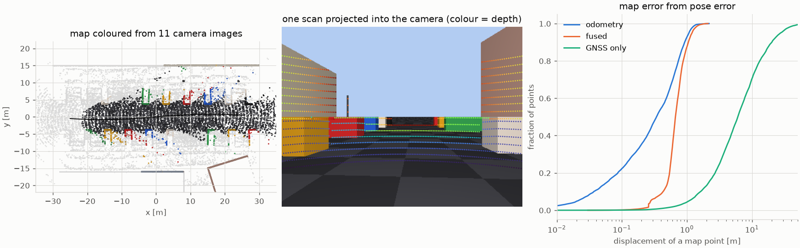

# 7 · Map building: aggregating scans, colouring from cameras

A single scan sees a few tens of metres and is sparse. Stacking many scans, each placed with the pose a
localization system gave it, builds a **map**: dense, extended, and — with cameras — coloured. The map is only as
good as the poses: every pose error moves all points of that scan. This chapter aggregates simulated scans with
true, odometry, fused and GNSS-only poses and measures the damage, then projects the map into camera images to
colour it, which needs the camera's pose (calibration) and an occlusion test.

Code: [`mapping.hpp`](../cpp/include/sensor_fusion/mapping.hpp), the camera in
[`sim.hpp`](../cpp/include/sensor_fusion/sim.hpp) ·
tests: [`test_mapping.cpp`](../cpp/tests/test_mapping.cpp) ·
notebook: [`07_map_building.ipynb`](../2_notebooks/solutions/07_map_building.ipynb)

---

## 7.1 Frames

Three frames are involved: the **world** (local ENU, chapter 2), the **vehicle** (the frame the localization
estimates, $(x, y, \psi)$ from chapter 6) and each **sensor** (LiDAR, camera), mounted rigidly on the vehicle. The
mounting $T_{VS}$ — the *extrinsic calibration* — is fixed and measured once; the sensor's pose in the world is

$$
T_{WS}(t) = T_{WV}(t)\, T_{VS}, \qquad
T_{WV} = \begin{pmatrix} \mathbf R_z(\psi) & (x, y, 0)^\top \\ \mathbf 0^\top & 1 \end{pmatrix}.
\tag{7.1}
$$

(A planar vehicle pose leaves roll, pitch and height out; on a sloped or bumpy road they must be estimated too.)

## 7.2 Aggregation

A point $\mathbf p$ of scan $k$, in the sensor frame, goes to the world with that scan's pose:

$$
\mathbf p^W = T_{WS}(t_k)\,\mathbf p .
\tag{7.2}
$$

Stacking all scans gives the map; a voxel grid (chapter 4) thins it to a uniform density. Two errors move a point:

* **position error** $\delta\mathbf t$ moves every point of the scan by $\delta\mathbf t$;
* **heading error** $\delta\psi$ rotates the scan about the sensor, moving a point at range $r$ by
  $2r\sin(\delta\psi/2) \approx r\,\delta\psi$ — 0.70 m at 40 m for 1° (checked in the tests). Heading is what makes a
  map blurry far from the vehicle.

**Measured** (Figure 7.1, right): a 16-beam LiDAR at 1.8 m drives 50 m along the lane of the demo parking lot at
2 m/s, 51 scans (460 000 points), each placed with four different pose sources. The table gives the RMS pose
error at the scan times and the RMS displacement of the map points from where the true poses put them:

| poses | position error | heading error | map points displaced (RMS / 95 %) |
|---|---|---|---|
| truth | 0 | 0 | 0 |
| odometry (chapter 6 model, 1 % scale error) | 0.48 m | 1.16° | 0.55 m / 1.07 m |
| fused odometry + GNSS (chapter 6) | 0.71 m | 0.84° | 0.75 m / 1.19 m |
| GNSS only (heading from consecutive fixes) | 1.77 m | 52.9° | 12.8 m / 27.5 m |

* **Over a short drive, odometry gives the sharpest map.** It has not drifted yet; the fused poses carry the
  GNSS noise (1.5 m) into every scan, filtered but not removed. GNSS makes the map *globally* right, odometry makes
  it *locally* consistent — real mapping systems use both, with smoothing over the whole drive (a pose graph,
  chapter 10 of the state-estimation module) rather than a causal filter, and register scans to the map (scan-to-map
  ICP) to remove the remaining blur.
* **GNSS alone cannot map.** At 2 m/s, consecutive 1 Hz fixes are 2 m apart with 1.5 m of noise each: the heading
  from them is off by 53° on average, and the map is scrambled.

## 7.3 Projection into a camera

A camera at $T_{WC}$ with intrinsics $\mathbf K$ (the pinhole model; the computer-vision module derives it) sees the
world point $\mathbf p^W$ at

$$
\mathbf p^C = T_{WC}^{-1}\,\mathbf p^W, \qquad
\begin{pmatrix} u \\ v \\ 1 \end{pmatrix} = \frac{1}{z^C}\,\mathbf K\,\mathbf p^C, \qquad z^C > 0 ,
\tag{7.3}
$$

with $T_{WC} = T_{WV}T_{VC}$ by (7.1). The module's simulator renders camera images by casting a ray through every
pixel centre against the same scene the LiDAR sees, so projection can be tested exactly: back-projecting a pixel
centre with its rendered depth and projecting again returns the pixel centre to $10^{-6}$ px.

Figure 7.1 (middle) projects one scan into the camera of the same instant: the rings of the LiDAR lie on the
surfaces of the image. That overlay is the standard visual check of a LiDAR–camera calibration.

## 7.4 Colouring the map

### Algorithm 7.1 — colour a map from images

For every image $k$ with pose $T_{WC,k}$:
1. Project all map points (7.3); keep those in front of the camera and inside the image.
2. **Occlusion test**: build a z-buffer of the map itself — the smallest projected depth per pixel — and accept a
   point only if its depth is within a tolerance (0.3 m) of the smallest depth in a small window (5 × 5 px) around
   its pixel. The window fills the gaps between the sparse projected points.
3. Give each accepted point the colour of its pixel, unless an image in which it was closer to the camera already
   coloured it.

**Why the occlusion test matters.** A point that the LiDAR saw but the camera did not — behind a car, from the
LiDAR's different viewpoint — still projects into the image, onto the car that hides it, and gets the car's
colour. On the drive above, with 11 images (every 5 m) of a camera 0.5 m ahead of the LiDAR: without the test 67 % of
the points are coloured and 79.4 % of those from the right surface; with it 42 % are coloured and 97.7 % correctly.
Leaving a point uncoloured is better than colouring it wrong.

**Calibration error.** A camera yaw that is off by 0.5° drops the correct fraction to 95.8 %, 1° to 93.3 %, 2° to
89.0 %: colours bleed across every edge, by $z\,\delta$ in the image plane. Time offsets between camera and LiDAR do the
same in motion.

*Figure 7.1 — Left: the aggregated map (true poses) coloured from 11 images with the occlusion test; grey points
were not seen by any camera. Middle: one scan projected into the camera image of the same instant, coloured by
depth. Right: distribution of the displacement of map points caused by odometry, fused and GNSS-only poses.
Generated by `tools/make_figures.py 7`.*

## 7.5 Real data

The recorded run of this module has planar scans and no camera, so the chapter works in simulation. Public
driving datasets provide what is missing — calibrated multi-beam LiDAR, cameras, GNSS-INS poses: nuScenes
(its *mini* split is a few gigabytes), KITTI, Argoverse. They are not redistributed here: `tools/get_data.sh` explains where to
get nuScenes-mini after accepting its terms of use. The functions of this chapter take plain arrays, so the
same code applies once the scans, poses, images and calibrations are loaded.

## 7.6 Common mistakes

- **Composing in the wrong order**: $T_{WS} = T_{WV}T_{VS}$, not $T_{VS}T_{WV}$.
- **Ignoring the motion during a sweep.** A spinning LiDAR takes 0.1 s per revolution; at 20 m/s the vehicle moves
  2 m during one scan. Each point needs the pose at its own time stamp (*deskewing*). The simulator here takes
  every scan from one pose.
- **Colouring without an occlusion test** — colours of foreground objects smear onto everything behind them.
- **Unsynchronized sensors.** A camera frame 50 ms away from the LiDAR sweep at 10 m/s is 0.5 m off.
- **Trusting heading from GNSS at low speed** — use the filter's heading (chapter 6) or a dual-antenna receiver.
- **Map blur blamed on the LiDAR** when it is the poses: check the displacement scale against range, $r\,\delta\psi$.

## 7.7 References

- R. Hartley, A. Zisserman, *Multiple View Geometry in Computer Vision*, 2nd ed., Cambridge, 2004 — chapter 6
  (the pinhole camera).
- H. Caesar et al., "nuScenes: a multimodal dataset for autonomous driving", *CVPR*, 2020.
- A. Geiger, P. Lenz, C. Stiller, R. Urtasun, "Vision meets robotics: the KITTI dataset", *IJRR* 32(11), 2013.
- J. Zhang, S. Singh, "LOAM: Lidar odometry and mapping in real-time", *RSS*, 2014 — scan-to-map registration and
  motion compensation.
- G. Pandey, J. R. McBride, S. Savarese, R. M. Eustice, "Automatic extrinsic calibration of vision and lidar by
  maximizing mutual information", *Journal of Field Robotics* 32(5), 2015.
