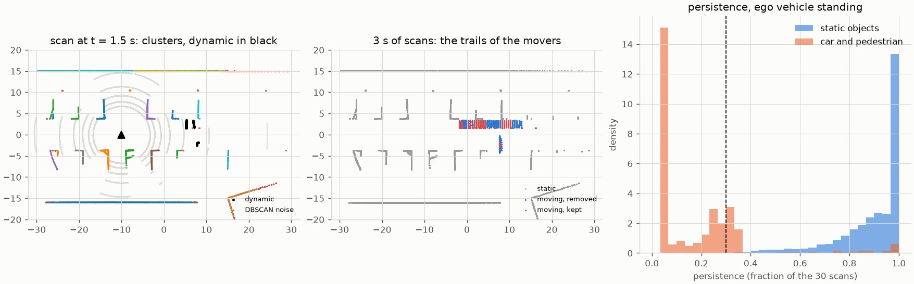

# 8 · Dynamic objects: ground removal, clustering, temporal consistency

Chapters 5–7 assumed a static world. Real scenes contain cars, cyclists and pedestrians that move: they corrupt
registration (points that moved pull ICP), leave **ghost trails** in maps, and are exactly what a vehicle must
avoid. This chapter separates them in three steps that need no learned model: remove the **ground**, group the
remaining points into objects by **clustering**, and call an object dynamic if it is **not persistent** over a
window of scans. Each step has a clear failure mode, measured here on a simulated scene with a moving car and a
crossing pedestrian.

Code: [`objects.hpp`](../cpp/include/sensor_fusion/objects.hpp), moving scene in
[`scenarios.py`](../python/sensor_fusion/scenarios.py) ·
tests: [`test_objects.cpp`](../cpp/tests/test_objects.cpp) ·
notebook: [`08_dynamic_objects.ipynb`](../2_notebooks/solutions/08_dynamic_objects.ipynb)

---

## 8.1 The test scene

The demo parking lot of chapter 4, plus two movers: a car (4.5 × 1.8 × 1.5 m) driving west at 5 m/s in the lane next
to the parked cars, and a pedestrian (0.6 × 0.6 × 1.8 m) crossing the lane at 1.2 m/s. A 16-beam LiDAR (±15°, 2°
between beams, 2 cm noise) 1.8 m above the ego vehicle takes 30 scans at 10 Hz. The simulator labels every point
with its object, so each step can be scored.

## 8.2 Ground removal

A large share of LiDAR points are ground (45 % of chapter 4's 32-beam scan, 25 % of the 16-beam scans here); they
connect everything and must go first.

**The naive way** — ground is every point lower than the sensor height minus a margin — works only while the
sensor stays level. It breaks on slopes, and on a flat road when the vehicle pitches: braking or a bump tilts
the sensor by a few degrees, and the ground far ahead rises above the threshold.

**RANSAC** fits a plane instead. A plane $\mathbf n^\top\mathbf p + d = 0$ with $\lVert\mathbf n\rVert = 1$ explains point $\mathbf p$ if

$$
\lvert \mathbf n^\top \mathbf p + d \rvert < \tau .
\tag{8.1}
$$

### Algorithm 8.1 — RANSAC ground plane

1. Repeat $N$ times: pick 3 random points, form the plane through them; skip it if its normal is more than
   $\theta_{\max}$ (15°) from vertical — otherwise a large wall, with more points than the ground, would win; count
   the points satisfying (8.1).
2. Refit the best plane to its inliers by PCA (chapter 4) and classify all points by (8.1).

With 25 % ground, a random triple is all ground with probability $0.25^3 = 1.6$ %; 200 iterations would miss every
such triple with probability $0.984^{200} \approx 4$ % — too often for a step that runs on every scan — and the
default of 500 iterations with $4 \cdot 10^{-4}$.

**Measured** (one scan, $\tau$ = 0.15 m): level sensor, both methods classify 98.3 % of the points correctly (the rest
are the bottoms of objects, within $\tau$ of the ground). Sensor pitched 3° nose-down: RANSAC finds the tilted plane
and keeps 97.5 %; the height threshold drops to 83.6 %, missing 1245 ground points — which then appear as obstacles.
The tests also check that RANSAC recovers a tilted plane to 0.2° next to a wall with more points than the ground.

## 8.3 Clustering with DBSCAN

The non-ground points are grouped by density (Ester et al. 1996). With the $\varepsilon$-neighbourhood

$$
N_\varepsilon(\mathbf p) = \{\mathbf q : \lVert\mathbf q - \mathbf p\rVert \le \varepsilon\},
\tag{8.2}
$$

a point is a **core** point if $\lvert N_\varepsilon(\mathbf p)\rvert \ge$ `min_points` (itself included); clusters are the sets of
core points connected through neighbourhoods, plus the **border** points within $\varepsilon$ of a core point; everything
else is **noise**.

### Algorithm 8.2 — DBSCAN

For every unvisited point: query $N_\varepsilon$ in the k-d tree (chapter 4); if it is not core, mark it noise (for now);
else start a new cluster and grow it breadth-first — every core point reached adds its neighbourhood to the queue,
border points join without expanding, and noise points reached are relabelled as border points.

DBSCAN needs no number of clusters and finds any shape; the tests check it against an $O(n^2)$ implementation of
the definition. Its two parameters encode what "connected" means, and both failure modes appear in the scene:

* **$\varepsilon$ too small for the beam spacing** — the rings of a 16-beam LiDAR are $r \cdot 2°$ apart: 0.63 m at 18 m. A
  pedestrian at that range is a few points per ring, and the rings must connect through the few points on each.
  With $\varepsilon$ = 0.6 m and `min_points` = 5, 276 of the pedestrian's 381 points (all scans) are noise; with
  `min_points` = 3, only 3.
* **$\varepsilon$ larger than the gap between objects** — the moving car passes 0.35 m from the parked cars and merges
  with them into one cluster, which is then mostly static: in 9 of the 30 scans with $\varepsilon$ = 0.5 m, in 14 with
  $\varepsilon$ = 1 m.

The defaults chosen from a small sweep, $\varepsilon$ = 0.5 m and `min_points` = 3, trade the two (the notebook shows the
others). Range-dependent $\varepsilon$, or
clustering in the range image (neighbouring beams and azimuth steps), handle both better.

## 8.4 Temporal consistency

A static object occupies the same place in the world in every scan; a moving one does not. With the scans in the
world frame (poses from chapter 6; here the true ones), count for each voxel $v$ of size $\ell$ in how many of the $N$
scans of the window it is occupied. The **persistence** of a point is that count for its voxel, divided by $N$:

$$
\pi(\mathbf p) = \frac{1}{N}\,\big\lvert\{\, j : \text{scan } j \text{ has a point in voxel } v(\mathbf p) \,\}\big\rvert ,
\tag{8.3}
$$

and a cluster $C$ is **dynamic** if its points are, on average, not persistent:

$$
\frac{1}{\lvert C\rvert}\sum_{\mathbf p \in C} \pi(\mathbf p) < \pi_{\min} .
\tag{8.4}
$$

Deciding per cluster rather than per point is what makes the test robust: a few static-looking points of a moving
car do not split it.

**Measured** (ego vehicle standing, 3 s window, $\ell$ = 0.5 m, $\pi_{\min}$ = 0.3; Figure 8.1): the median persistence of
static objects is 0.93, of the movers 0.03. 99 % of the points flagged dynamic belong to the car or the pedestrian
(precision), and 72 % of their points are flagged (recall). The 28 % missed: 188 points within $\tau$ of the ground,
114 DBSCAN noise, and 270 in clusters judged static. These are mostly the car's long **sides**: an object moving
along its own length keeps occupying the same voxels with its sides for $\text{length}/\text{speed}$ = 0.9 s — persistence 0.3
— the aperture problem of motion detection, visible in the histogram of Figure 8.1.

**Ego motion.** With the ego vehicle driving at 2 m/s, recall rises to 0.80 but precision falls to 0.63: static
surfaces that come into view during the window, or are seen from a new angle, are occupied in only part of the
scans and look dynamic. Persistence cannot tell "not there" from "not seen". Free-space reasoning fixes this: cast
each ray and count a voxel as *empty* only where a ray passed through it (occupancy grids, OctoMap; map-cleaning
methods such as Removert and ERASOR build on this).

*Figure 8.1 — Left: one scan with ground (light grey), DBSCAN clusters (colours), noise (red) and the clusters
flagged dynamic (black); the ego vehicle at the triangle. Middle: 3 s of scans without the ground: the car and
the pedestrian leave trails, blue where the filter removes them, red where it keeps them. Right: persistence of
static and moving points, with the threshold. Generated by `tools/make_figures.py 8`.*

## 8.5 Common mistakes

- **Height-threshold ground removal** on anything but a level sensor on flat ground.
- **One $\varepsilon$ for all ranges** — too small far away (objects shatter into noise), too large near the sensor (objects
  merge). Scale it with range or cluster in the range image.
- **Judging motion per point** instead of per object — the sides of a long moving object look static.
- **Persistence without visibility** — "not seen" is not "not there"; with ego motion, use ray casting.
- **Windows shorter than the motion** — a pedestrian at 1.2 m/s needs a second to leave its voxel; a parked car
  that starts moving needs a window spanning before and after.
- **Removing dynamic points after registration** — moving objects bias ICP (chapter 5); remove them first, or
  register with a robust (trimmed) metric.

## 8.6 References

- M. A. Fischler, R. C. Bolles, "Random sample consensus", *Communications of the ACM* 24(6):381–395, 1981.
- M. Ester, H.-P. Kriegel, J. Sander, X. Xu, "A density-based algorithm for discovering clusters in large
  spatial databases with noise", *KDD*, 1996.
- I. Bogoslavskyi, C. Stachniss, "Fast range image-based segmentation of sparse 3D laser scans for online
  operation", *IROS*, 2016.
- A. Hornung, K. M. Wurm, M. Bennewitz, C. Stachniss, W. Burgard, "OctoMap: an efficient probabilistic 3D mapping
  framework based on octrees", *Autonomous Robots* 34(3):189–206, 2013.
- G. Kim, A. Kim, "Remove, then revert: static point cloud map construction using multiresolution range images",
  *IROS*, 2020.
- H. Lim, S. Hwang, H. Myung, "ERASOR: egocentric ratio of pseudo occupancy-based dynamic object removal for fast
  static map building", *IEEE RA-L* 6(2):2272–2279, 2021.
