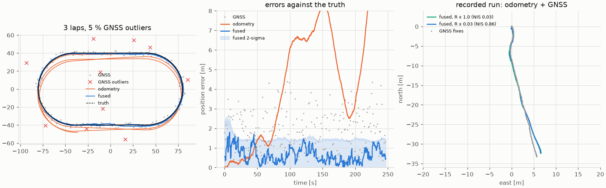

# learn-sensor-fusion

GNSS, LiDAR and their fusion for vehicle localization and mapping: from NMEA sentences and coordinate frames to
point clouds, ICP odometry, a GNSS + LiDAR Kalman filter, map building and dynamic-object removal. Each chapter has
a theory text, a C++17 library (`sensor_fusion`) that implements it with tests, and Python notebooks that call the
library on recorded GNSS logs and LiDAR scans and on a simulator with exact ground truth.



*Chapter 6: odometry drifts, GNSS jumps, the gated filter follows the truth; right, the recorded run.*

## Chapters

| # | Chapter | Theory | Code | Notebook |
|---|---------|--------|------|----------|
| 1 | GNSS fundamentals: pseudoranges, least-squares fix, NMEA 0183 | [text](1_theory/01_gnss_fundamentals.md) | [gnss.hpp](cpp/include/sensor_fusion/gnss.hpp) · [nmea.hpp](cpp/include/sensor_fusion/nmea.hpp) | [exercises](2_notebooks/exercises/01_gnss_fundamentals.ipynb) · [solutions](2_notebooks/solutions/01_gnss_fundamentals.ipynb) |
| 2 | Coordinate frames: WGS-84, ECEF, ENU, UTM | [text](1_theory/02_coordinate_frames.md) | [geodesy.hpp](cpp/include/sensor_fusion/geodesy.hpp) | [exercises](2_notebooks/exercises/02_coordinate_frames.ipynb) · [solutions](2_notebooks/solutions/02_coordinate_frames.ipynb) |
| 3 | GNSS quality: DOP, fix types, precision, motion vs standstill | [text](1_theory/03_gnss_quality.md) | [gnss_quality.hpp](cpp/include/sensor_fusion/gnss_quality.hpp) | [exercises](2_notebooks/exercises/03_gnss_quality.ipynb) · [solutions](2_notebooks/solutions/03_gnss_quality.ipynb) |
| 4 | Point clouds: PCD files, voxel grid, k-d tree, normals | [text](1_theory/04_point_clouds.md) | [cloud.hpp](cpp/include/sensor_fusion/cloud.hpp) · [sim.hpp](cpp/include/sensor_fusion/sim.hpp) | [exercises](2_notebooks/exercises/04_point_clouds.ipynb) · [solutions](2_notebooks/solutions/04_point_clouds.ipynb) |
| 5 | Registration: ICP point-to-point and point-to-plane, NDT, LiDAR odometry | [text](1_theory/05_registration.md) | [registration.hpp](cpp/include/sensor_fusion/registration.hpp) | [exercises](2_notebooks/exercises/05_registration.ipynb) · [solutions](2_notebooks/solutions/05_registration.ipynb) |
| 6 | Loosely coupled GNSS + LiDAR fusion: EKF, gating, consistency | [text](1_theory/06_gnss_lidar_fusion.md) | [fusion.hpp](cpp/include/sensor_fusion/fusion.hpp) | [exercises](2_notebooks/exercises/06_gnss_lidar_fusion.ipynb) · [solutions](2_notebooks/solutions/06_gnss_lidar_fusion.ipynb) |
| 7 | Map building: aggregating scans, colouring from cameras | [text](1_theory/07_map_building.md) | [mapping.hpp](cpp/include/sensor_fusion/mapping.hpp) | [exercises](2_notebooks/exercises/07_map_building.ipynb) · [solutions](2_notebooks/solutions/07_map_building.ipynb) |
| 8 | Dynamic objects: ground removal, DBSCAN, temporal consistency | [text](1_theory/08_dynamic_objects.md) | [objects.hpp](cpp/include/sensor_fusion/objects.hpp) | [exercises](2_notebooks/exercises/08_dynamic_objects.ipynb) · [solutions](2_notebooks/solutions/08_dynamic_objects.ipynb) |

Notation is fixed once in [1_theory/00_notation.md](1_theory/00_notation.md). Every number in the theory texts is
printed by `tools/make_figures.py` or the notebooks.

## Data

Small recorded files live in [`data/`](data/README.md): two NMEA logs of a consumer receiver (standing and walking),
GNSS fixes of three runs in a parking lot, and 484 planar LiDAR scans of one of them. Chapters 4–8 also use a
built-in simulator (ray-cast LiDAR and camera in a parking-lot scene) for experiments with exact ground truth.
Larger public datasets are not redistributed; [`tools/get_data.sh`](tools/get_data.sh) explains how to obtain them.

## Quick start

```bash
sudo apt install build-essential cmake libeigen3-dev python3-venv
make test                                   # C++ library and Catch2 tests
python3 -m venv .venv && source .venv/bin/activate
pip install -e ".[notebooks]"               # builds the Python module sensor_fusion (pybind11)
```

Then open `2_notebooks/exercises/` in Jupyter or VS Code; each notebook also runs on Colab (its first cell
installs the module). Details are in [HOW_TO_RUN.md](HOW_TO_RUN.md).

```python
import sensor_fusion as sf
odo = sf.reg.lidar_odometry(scans, "point_to_plane")      # chapter 5
```

## Layout

```
1_theory/      chapter texts and figures
2_notebooks/   exercises/ (to fill in) and solutions/ (executed)
cpp/           include/sensor_fusion, src, tests (Catch2), examples
python/        bindings, data loading, synthetic scenarios, plotting
tools/         figure generator, notebook runner, exercise generator, data script
data/          small recorded GNSS and LiDAR files
```

## Used in

* [robotics-learning](https://github.com/Rudip1/robotics-learning) — the umbrella of all learn-* modules.
* [learn-state-estimation](https://github.com/Rudip1/learn-state-estimation) — Kalman filters and pose-graph
  SLAM in depth; this module's chapter 6 filter is a specialised case.

## Licence

Code: Apache-2.0 ([LICENSE](LICENSE)). Theory texts and figures in `1_theory/`: CC BY 4.0. Provenance of the
recorded data: [data/README.md](data/README.md).
